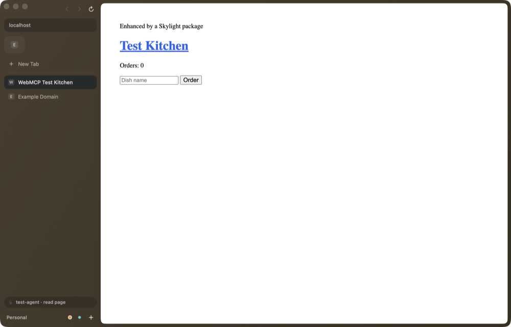

# Skylight



An open-source browser for macOS with Spaces and a vertical sidebar, built in Swift on the system's
WebKit. The shell is stock macOS: a source-list sidebar, one unified toolbar, a Settings window and system
alerts, so it looks and behaves like Safari or Finder. Built to be light, easy to extend, and
usable by AI agents as a first-class citizen.

## Download

[Download Skylight for Mac](https://github.com/potatoman03/skylight/releases/latest/download/Skylight.dmg)
(macOS 26 or later, Apple silicon), or see [the website](https://potatoman03.github.io/skylight/).
It updates itself after that.

## Build and run

### Requirements

- macOS 26 on Apple silicon.
- Xcode 26 with Swift 6.2 or later (`swift --version`).

### Build and run

```bash
scripts/bundle.sh
open build/Skylight.app
```

`scripts/bundle.sh release` makes an optimized build, and `OPEN=1 scripts/bundle.sh` builds, then
launches.

If you already run a copy of Skylight, `open` brings that one to the front instead, since both
have the same bundle id. Start the new build's executable directly instead (see the next section).

### Demo mode

For trying a change without touching your own tabs, cookies or passwords:

```bash
SKYLIGHT_DEV=1 SKYLIGHT_DATA_DIR="$(mktemp -d)" build/Skylight.app/Contents/MacOS/Skylight
```

- `SKYLIGHT_DATA_DIR` puts every file Skylight writes in that folder instead of
  `~/Library/Application Support/Skylight` (`state.json`, `preferences.json`, `Packages/`,
  `Engine/`, `mcp.json`). Cookies and site data are the exception: WebKit keeps those in its own
  stores under `~/Library/WebKit`, and each data folder gets its own.
- `SKYLIGHT_DEV=1` keeps passwords in memory, with three made-up logins, instead of your login
  Keychain.

### Tests

```bash
swift test
```

243 tests in Swift Testing, over SkylightCore, SkylightKit and SkylightMCP. They use temporary
folders and in-memory stores only. `swift test -c release --filter Performance` prints the timings
quoted under Performance below.

### Signing

By default `bundle.sh` signs ad hoc. That's enough to run on your own Mac. An ad hoc build is a
development build (`SkylightDevBuild` in its Info.plist), which doesn't update itself.

To sign with your own certificate, put it in `.signing` at the top of the repo. Git ignores the
file, so never commit it, and never put anything other than these variables in it:

```bash
SKYLIGHT_SIGN_IDENTITY="Developer ID Application: You (TEAMID)"
# Optional: a profile with Apple's web-browser.public-key-credential entitlement, for passkeys.
SKYLIGHT_PROVISIONING_PROFILE=path/to/Skylight.provisionprofile
```

`bundle.sh` reads it on every build (variables already set in your shell win). A signed build uses
the hardened runtime and your real Keychain.

The app icon is drawn in code: edit `scripts/make-icon.swift` and run it to regenerate
`Resources/AppIcon.icns`.

### Releases and updates

Signed builds update themselves with [Sparkle](https://sparkle-project.org). Every few hours they
read the feed on the repo's latest GitHub release and download a new version quietly. Then a card
at the bottom of the sidebar offers to restart; otherwise it installs when Skylight quits.
Skylight → Check for Updates… checks right away. Only builds signed with the project's update key
are installed. Development builds
(ad hoc, or `SKYLIGHT_DEV=1`) never update.

- `scripts/publish.sh 0.2.0` makes a release: it runs `scripts/release.sh`, signs the zip with the
  update key, writes `appcast.xml`, and puts them with `Skylight.dmg` on a GitHub release. Installed
  copies pick it up from there, and the website's download link always gets the newest DMG. The
  top of the script lists what it needs. The repo has to be public for installed copies to
  download from it.
- `scripts/release.sh 0.2.0` builds `build/Skylight-0.2.0.dmg`: signed with a Developer ID,
  notarized and stapled, so a first install opens without warnings. It needs a Developer ID
  Application certificate and notary credentials saved with `xcrun notarytool
  store-credentials`.

## Modules

Skylight is one Swift package. Each module is a target in `Package.swift`, and depends only on
modules above it in this list:

| Module | What's in it |
|---|---|
| `SkylightCore` | State, actions, the reducer and store, persistence, themes, splits, omnibox parsing. No AppKit, no engine. |
| `SkylightEngine` | The `WebEngine`, `WebPage` and `ExtensionHost` protocols the rest of the app uses for web pages. |
| `SkylightKit` | Packages and boosts, Chrome extension manifests, native messaging hosts, passwords (Keychain, CSV, Chromium import). |
| `SkylightAgent` | The agent tool hub, built-in browser tools, page scripts and WebMCP. |
| `SkylightMCP` | The Model Context Protocol server on `127.0.0.1`. |
| `SkylightBrowser` | `Browser`, the object that owns every service and connects them: the store, pages, prompts, packages, agents, passwords, extensions, media. |
| `SkylightUI` | The SwiftUI window: sidebar, toolbar, address field, page area, Settings. |
| `SkylightWebKit` | The engine, over WebKit. Only this module knows about it. |
| `Skylight` | The app executable. |

[AGENTS.md](AGENTS.md) has the full map, where each kind of change goes, and the rules that keep it
working. [CONTRIBUTING.md](CONTRIBUTING.md) covers branches, commits and pull requests.
[docs/architecture.md](docs/architecture.md) lists known boundary problems and proposed fixes.

## Using it

| | |
|---|---|
| ⌘T | New tab: the address field opens for a search, a URL, any open tab or a command |
| ⌘L | Edit the current address |
| ⌘⇧R | Reload without the cache |
| ⌘W / ⌘⇧T | Close tab / reopen it |
| ⌘D / ⌘⇧D | Pin the tab / add it to favorites |
| ⌘⇧K | Clear Today |
| ⌘S | Show or hide the sidebar |
| ⌘, | Settings |
| ⌃Tab | Next tab |
| ⌃1–9, ⌥⌘←/→ | Switch Space |
| ⌘⇧N | New Space |
| ⌃⌘N | Open a new tab beside this one, in a split |
| ⌃⌘[ / ⌃⌘] | Focus the previous / next pane of a split |
| ⌃⌘R | Rotate a split (side by side ↔ stacked) |
| ⌥⌘P | Picture in Picture |
| ⌘⇧B | Boost this site |
| ⌥⌘I | Developer tools, beside the page |

The sidebar works like Arc's. Each Space has its own **favorites** at the top, its **pinned** tabs,
then **Today** (with **Clear**). Drag tabs between sections; the list shows an
insertion line where a tab will land, and holding a tab over a Space's button at the bottom
switches to that Space so you can drop it there. Swipe two fingers sideways over the sidebar to go
to the next or previous Space; it stops at the first and last. Links dragged in from a page or
another app open where you drop them. Closing a
pinned tab or favorite only unloads it; Delete in its menu removes it. Today tabs untouched for 12
hours are archived (⌘⇧T brings them back; the time is in Settings). Pages you haven't looked at in
20 minutes go to sleep and reload when you return.

Each Space has a color, an icon and a **profile**. A profile keeps its own cookies, site logins,
saved passwords and extension data, so Spaces on different profiles can be signed in to different
accounts, and switching Space shows only that Space's accounts.

**New Space** asks what the Space keeps from the current one, and remembers your last choice, so
Return is usually all it takes. **Everything** shares the current Space's profile, so its logins,
saved passwords and extensions carry over. **Only these** gives it its own profile, signed out
except for Google or GitHub if you tick them; those sign-ins are copied once, and an extension's
data is copied the same way. Saved passwords stay shared both ways with the Space you started from,
unless you untick them, and a shared password only offers to fill: it never signs that Space in.
Some sites may still ask you to sign in again after a copy, and a password manager extension may
ask you to unlock it.

**Duplicate Space** in a Space's menu shares everything and also copies its look (not its tabs).
**New Profile for This Space**, in a Space's menu under Profile, asks the same questions for a Space
you already have. Settings → Profiles names profiles and gives each an icon and color; Settings →
Spaces picks each Space's profile. Deleting a Space keeps its profile; deleting a profile moves its
Spaces and saved passwords to Default.

**Themes.** Pattern themes draw a live field of characters over the sky, with nothing to download.
Playful ones include Deep Space, Pink Princess, Terminal, Synthwave and Golden Hour; quiet ones,
such as Linen, Sage, Fog, Clay and Sumi, keep to soft colors and faint patterns. Picture themes are
whole scenes, from Nebula and Northern Lights to Greenwood and Hanami. Skylight starts in Skylight
Default. Settings → Themes picks one for all your Spaces, or a different one for any Space.

**Sidebar.** Each Space can have its own icon or emoji, color, sidebar tint and theme, from its ···
menu or Tabs → Customize Space….

**Appearance.** Skylight follows the system's light or dark mode, and web pages follow with it. Glass is the plain look; a theme puts a sky, pattern or picture behind the source list. Sky,
Pastel and Vivid follow each Space's color; Paper, Graphite, Dusk, Forest, Ocean, Rosé and Aurora
keep their own.

**Passwords** live in your login Keychain, separately for each profile. After you sign in somewhere
new, Skylight offers to save the login; a key in the address field fills a saved one when you pick
it, and only offers the current Space's. Filling only happens from Skylight's own UI, and only into
a page on the login's site. Passkeys in iCloud Keychain aren't available in Skylight yet, and would
follow your Apple ID rather than a Space. Settings → Passwords imports from
Aside, Arc, Helium, Chrome, Dia, Brave, Edge and other Chromium browsers on this Mac (macOS asks before
Skylight can read that browser's key), or from a CSV export (Chrome, Safari, 1Password, Bitwarden).
Copying and exporting ask for Touch ID or your password.

**Import** (File → Import From, or Settings → Import) brings a browser's saved passwords and
sign-ins into the Space on screen, after macOS asks to let Skylight read that browser's key. It also
brings over Arc's Spaces, pinned tabs and favorites, or a Chromium browser's bookmarks: the bookmarks
bar becomes favorites and each folder a Space, which is how Aside's sidebar folders come across.
Arc's other profiles become profiles here, and their Spaces keep their own logins and favorites.
Passwords saved to a Google Account come too, as long as the browser keeps a copy on this Mac; if
not, export them from passwords.google.com and import the CSV. So do your history (the latest 20,000
pages), saved addresses and cards, and the extensions you have on, fresh from the Chrome Web Store,
so sign in to them again. Passkeys and cards kept in Google Pay can't leave. Safari and Apple
Passwords keep logins from other apps, so those come from a CSV export.

**Addresses and cards** live in your login Keychain, separately for each profile, and show under
Settings → Passwords. The person icon in the address field fills a form when you pick one, on the
page itself; payment boxes embedded from another site can't be reached yet. A card asks for Touch ID
or your password first and only goes to a secure page. Security codes are never saved.

**History** (⌘Y) is kept per profile, on this Mac, and the address field suggests from it. Clear it
from the history sheet.

A new install opens with a short **welcome**: import from another browser, pick a look, make
Skylight the default browser, and a few things worth knowing. Help → Welcome to Skylight brings it
back.

The sky is a small Metal shader: light falls through it, slowly, in the theme's colors. It runs at
30 fps only while it's showing and the window is in front, and stops with Reduce Motion or when
"Light through the sky" is off.

**Split view.** Drag a tab onto the page and drop it on a side (the drop zone shows where it will
go), or pick Open in Split View from a tab's menu, or press ⌃⌘N. Up to four panes go side by side or
stacked, with a hairline between them. Drag a divider to resize (double-click it to make the panes
equal), drag a pane's grip to move it or pull it out of the split, and click a pane to focus it. The
sidebar shows a split as one row; selecting any of its tabs shows them all. Hover a tab in that row
for – to take it out of the split, or × to close it.

**Picture in Picture.** ⌥⌘P (or a tab's menu, or the address field) puts the page's main video in a
floating window. Leave a tab with a video playing and it follows you in Picture in Picture; come
back and it returns to the page. Tabs playing sound show a speaker you can click to mute.

**Chrome extensions.** Settings → Extensions installs from a Chrome Web Store link (or the Web
Store button) or from an unpacked folder. Pinned extensions get a button in the toolbar; the rest
are in the Extensions menu (puzzle piece) next to them, where you pin and unpin. Settings can put
them all in the menu. Right-click a button to open its options or remove it. Popups open as bubbles sized to
their content. They run on WebKit's own support for web extensions, so they get the standard APIs
(`tabs`, `windows`, `storage`, `runtime` and the rest) over Skylight's own tabs. Every profile runs
them, each with its own storage and its own tabs, so a password manager extension signs in
separately in each. Adding, turning off and removing one all take effect straight away. WebKit
leaves out a few Chrome APIs (`runtime.onUpdateAvailable`, `offscreen` and others), so extensions
with a service worker run from a private copy that stands in for them. Offscreen documents don't
work, which for Proton Pass means it can't clear the clipboard after a delay. Badges don't show yet, `tabs.create` opens the tab without returning it, and extensions can't talk to a companion
app on your Mac (native messaging), which some password managers need to unlock.

## Packages

A package is a folder in `~/Library/Application Support/Skylight/Packages` with a `skylight.json`:

```json
{
  "id": "dev.you.reader",
  "name": "Reader tweaks",
  "matches": ["*://*.nytimes.com/*"],
  "styles": ["style.css"],
  "scripts": ["page.js"],
  "commands": [{ "id": "focus", "title": "Focus mode" }]
}
```

```js
// page.js runs at document start in matching pages. `skylight` is the package's API.
skylight.onReady(() => { /* the DOM is parsed */ });
skylight.addStyle('aside { display: none }');
skylight.command('focus', () => document.body.classList.toggle('focus'));
```

Saving a file reloads the package. CSS changes apply to open pages immediately; script changes
apply on the next load. Commands show up in the address field on matching sites. View → Boost This
Site (⌘⇧B) creates a package for the current site and opens its stylesheet.

## Agents (MCP and WebMCP)

Skylight runs a Model Context Protocol server on `127.0.0.1` (Streamable HTTP). Copy the connection
command from the Skylight menu (or the address field: "Copy Claude Code connection command"):

```bash
claude mcp add --transport http skylight http://127.0.0.1:47831/mcp --header "Authorization: Bearer <token>"
```

Tools: `list_tabs`, `open_tab`, `navigate`, `go_back`, `go_forward`, `reload`, `select_tab`,
`close_tab`, `switch_space`, `read_page`, `click`, `type_text`, `scroll`, `call_site_tool`,
`run_package_command`, `list_packages`. Reading is free; anything that changes something shows an
approval alert first ("Allow for This Session" skips it for that agent until you quit).

Sites can offer their own tools through **WebMCP** (`navigator.modelContext`, the W3C community
group draft). Skylight provides the API in every page and forwards registered tools to agents: the
selected tab's tools appear as `site_<host>__<tool>`.

```js
navigator.modelContext.registerTool({
  name: 'search_flights',
  description: 'Searches flights between two airports.',
  inputSchema: { type: 'object', properties: { from: { type: 'string' }, to: { type: 'string' } } },
  execute: async ({ from, to }) => searchFlights(from, to),
});
```

The token in `mcp.json` (mode 600) is required on every request, and requests with a non-local
`Origin` are refused.

## Performance

Measured on an M5 Pro, release build, with `swift test -c release --filter Performance`.
`scripts/bench.py` measures launches, memory and bundle size on your own Mac. Skylight.app is 18 MB:
the engine is part of macOS.

| Hot paths | |
|---|---|
| The sky shader | 0.28 ms of GPU per frame at 1280×820, 30 fps: under 1% of the GPU, and zero while the window is in the background |
| A reducer action (open, select, close a tab) | 13–35 µs |
| Saving / loading 2,000 tabs | 12 ms / 18 ms (510 KB) |
| An MCP tools/list + tools/call round trip | 60 µs |
| Matching a package URL pattern | 0.7 µs |
| Importing 500 pinned tabs from Arc | 4 ms |

## Architecture

```
Skylight (app) ─┬─> SkylightUI ──> SkylightBrowser ─┬─> SkylightCore     state, reducer, store (pure)
                │                                   ├─> SkylightEngine   WebEngine protocols
                │                                   ├─> SkylightKit      packages, extensions, passwords
                │                                   ├─> SkylightAgent    tool hub, page scripts, WebMCP
                │                                   └─> SkylightMCP      MCP over local HTTP
                └─> SkylightWebKit ──> WebKit
```

- **One source of truth.** Every change, from a click, a shortcut, a package or an agent, is a
  `BrowserAction`. `BrowserReducer` applies it to `BrowserState` and returns `BrowserEffect`s; it
  never touches the engine. `PageCoordinator` turns effects into engine calls.
- **Tabs are not pages.** A tab is a saved place; a page is a live engine object that exists only
  while the tab is awake. Pages are created lazily and put to sleep by `HibernationPolicy`.
- **The engine is swappable.** Only `SkylightWebKit` knows about WebKit.
- **System components first.** The window is a `NavigationSplitView` whose SwiftUI toolbar is
  bridged into the window's `NSToolbar`; the sidebar is a `List` with system drag and drop;
  Settings is an `NSTabViewController` of grouped `Form`s; prompts are alerts. Custom drawing is
  limited to what the system has no control for: split dividers, pane grips and the sky.

## Roadmap

1. **Now:** the system's WebKit, with video codecs and DRM from macOS.
2. Native messaging for extensions, badges, web notifications, and passkeys (they need an Apple
   entitlement for browsers).
3. Tab sync between machines, easels, notes and highlights as built-in packages, an in-app agent.

Known limits: extensions' data doesn't carry over from another browser or between Spaces; Google
account sync is unavailable; Widevine isn't available, so DRM video depends on a site offering
FairPlay. Older versions ran on Chromium: the first launch of this one moves your sign-ins across
from them, and saved site data other than cookies stays behind. Docked Web Inspector uses a private
WebKit call.

## License

MIT.
